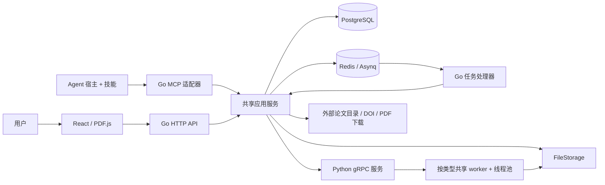

# 总体架构与实现

[文档导航](README.md) · [运行与配置](running.md)

本文集中说明代码分层、数据归属和主要执行流程。使用步骤放在运行指南；精确的笔记和
MCP 格式分别以专项契约为准，不把 README 作为接口规范。

## 1. 服务与部署

Go 是业务和持久化的所有者。Python 负责从 PDF/Markdown 提取与渲染，不直接写业务数据库。
前端负责 PDF 显示、交互和笔记渲染。MCP 复用应用服务，技能负责阅读策略和输出模板。

| 启动方式 | 组件管理 | 网页提供方式 |
| --- | --- | --- |
| 源码开发 | Docker 管数据库/Redis；开发脚本管理 Go、Python、Vite | Vite 开发服务器代理 API |
| 完整 Compose | 各服务由 Compose 管理 | Web 容器提供静态站点并代理 API |
| 解压运行 | Go Launcher 管理私有 PostgreSQL、Redis、Python、Go API | Go 提供预构建静态网页 |

只有一套业务代码；没有为桌面版复制另一套后端。Node.js 参与前端构建，不是发行运行依赖。

## 2. 代码入口与职责

| 位置 | 职责 |
| --- | --- |
| `cmd/server/`、`internal/runtime/server/` | API 进程入口、依赖组装、启动与关闭 |
| `cmd/launcher/`、`internal/runtime/desktop/` | 本地管理页、私有进程生命周期、初始化和可选维护 |
| `internal/router/`、`internal/handler/` | HTTP 路由、请求校验、Asynq 注册与任务状态适配 |
| `internal/application/service/` | 识别、检索、引用、Base、笔记等应用流程 |
| `internal/application/repository/` | PostgreSQL 查询和持久化事务 |
| `internal/types/interfaces/`、`internal/types/` | 服务端口、领域数据和操作契约 |
| `internal/infrastructure/` | gRPC、目录提供方、下载、DOI 和渲染等外部适配 |
| `internal/mcp/` | MCP 注册表、工具参数和应用服务适配 |
| `web/src/` | PDF 阅读、引用匹配、笔记编辑、翻译与书目展示 |
| `pdf_parser/papers_parser/`、`pdf_parser/paper_crf/` | 轻量 gRPC 服务、worker、PDF 解析与模型资源 |
| `proto/document_parser.proto`、`gen/papers/v1/` | 跨语言契约和生成的 Go 代码；Python 桩位于 `pdf_parser/` |
| `migrations/postgres/` | 启动时可自动执行的版本化数据库迁移 |

HTTP 处理器将安全的 `ServerError` 交给错误中间件统一输出。日志使用结构化 `slog`，
记录操作上下文和安全标识，不把论文正文、上传内容或凭据写入日志。

## 3. 数据归属

| 资源 | 持久化位置与含义 |
| --- | --- |
| `documents` | 原文件标识、存储 key、类型和文档处理生命周期 |
| `paper_metadata` | 论文正式标题、作者、摘要、DOI、来源、卷期页码、标签等 |
| `paper_citations` | 某篇论文的一条参考文献；同一被引论文在不同论文中仍是不同引用行 |
| `document_bases`、`document_base_files` | 命名集合及成员关系；增删成员不复制或删除源论文 |
| `document_blocks` | 解析块、页码、页面尺寸、bbox、文本及 Markdown 位置；图片/表格关联独立资产 |
| 源目录 | 识别时获得并持久化的 PDF 原生目录或 Markdown 标题回退结果 |
| 阅读笔记目录 | 数据库保存章节关系、顺序、revision 等结构；不保存 Markdown 正文 |
| FileStorage | 原文件、识别 Markdown、图片和 `notes/{document_id}/` 下的章节文件 |
| Redis | Asynq 队列、保留期内的任务结果及共享外部请求限速状态 |

数据库与文件必须一起考虑，复制原 PDF 不能恢复元数据、引用和笔记目录。
`UPLOAD_DIR` 是本地 FileStorage 的根，因此实际笔记路径通常为
`UPLOAD_DIR/notes/{document_id}/...`，不是仓库根目录下的 `notes/`。

源结构读取另有可重建 JSON 缓存，源码默认位于 `data/runtime/document-structures/`。
它不是真值；删除缓存后从持久化源目录重建，不必重新解析 PDF。
`DOCUMENT_STRUCTURE_CACHE_DIR`、`DOCUMENT_STRUCTURE_CACHE_ENTRIES`、
`DOCUMENT_STRUCTURE_CACHE_MAX_BYTES` 控制其位置和边界。

## 4. 上传、识别与源结构

1. HTTP/MCP 校验输入，把原文件交给 FileStorage，创建文档并提交识别任务。
2. Asynq worker 取得 Go 识别准入后再加载必要资源，调用 Python gRPC。
3. 已存储的 PDF 优先传相对 `source_storage_key`，Python 在共享 `UPLOAD_DIR` 内打开文件。
   共享源缺失或旧解析器不支持 key 时才按既有机制回退 bytes；路径越界、权限、超限或解析
   错误不会因回退而绕过限制。
4. Python 返回清洗后的 Markdown、布局 Blocks、图片/表格预览和源目录；Go 保存文件、
   事务性写入解析数据并推进文档状态。
5. 文档解析成功后即可阅读；元数据提取和外部目录查询独立继续。

目录优先采用可用的 PDF 原生书签；没有时从最终解析 Markdown 的标题构建。
解析响应中的 block ordinal 和 Markdown Unicode code-point 区间用于建立位置映射。
Go 持久化后每个 Block 还有自己的数据库 ID，不能把 ordinal 当作跨次识别稳定的 ID。

结构接口返回紧凑目录和位置提示，不携带全部 Blocks；前端通过按页读取 Blocks 获取布局。
原生目录可能只有页码/位置提示，不保证能为每节返回一段准确的 Markdown 切片。

## 5. Python 并发与内存

项目示例配置和 Launcher 选用的 `shared` 模式保留轻量 gRPC 服务。
识别、提取、渲染各自按需启动共享 worker，
每类 worker 内使用线程池处理多项任务，重用重型依赖与模型；不是为每个 RPC 新建解释器。

- Go Asynq 默认 32 个任务 worker，但识别/提取各有默认 4 个准入名额。
- Python 识别/提取各默认 4 并发，gRPC 总预算默认 8；渲染同样受总预算及自身限制约束。
- `PARSER_*_WORKER_MAX` 是进程池相关配置，不能在 shared 模式下把它当作线程并发开关。
- worker 空闲后退出；轻量服务继续常驻。原生库分配器和模型缓存可能暂时保留 RSS。
- 识别、提取、渲染有各自超时、输入输出和图像大小限制；不要只提高外层并发而忽略内存预算。

页/区域截图通过 `PdfRenderer.RenderPage` 同步调用渲染 worker，不经过 Asynq。
解析时保存的预览默认 144 DPI；按需渲染则受独立 DPI、像素和输出字节上限约束。
Python 的底层协议、模型与诊断材料仍保留在组件目录，日常配置从[运行指南](running.md)进入。

## 6. 元数据、目录查询与引用

处理阶段分别为 `markdown`、`metadata_extraction`、`source_lookup`、`reference_lookup`。
各阶段有独立取消/重试和 generation 检查；较旧任务完成时不能覆盖新一轮结果。
外部查询失败不会把已经可读的文档重新标为解析失败。

Python 只提取候选信息。Go 负责与 arXiv、Semantic Scholar、OpenAlex、Crossref 等目录交互、
比较候选和写入规范化源信息。原始引用在创建后先按 DOI/title 匹配库内已有文档；
匹配本地记录不需要外部请求。引用的外部查询默认按需触发。

目录调度器位于 Go 进程内，每个提供方一个 worker，优先处理论文本身的源信息查询。
引用查询另有全局和单文档准入，默认分别为 2 和 1；每个提供方仍受间隔、超时、退避和
共享限速约束。Redis 的用途不只有 Asynq，还包括提供方/下载的共享限速状态。

源查询遇到精确 DOI/arXiv 命中或达到提前结束阈值后可停止；否则继续尝试其他提供方。
结果经任务写入持久化层，比较当前候选而非按最后返回者直接覆盖。
目录调度队列和在途状态在进程内；重启时中断阶段会被显式标记失败，用户可以重试，
不能把 Redis 队列持久化理解成所有目录调度都能自动续跑。

引用 PDF 下载是用户显式触发的独立工作，使用隔离的 `download` 队列。
下载逐跳检查目标地址、限制大小和重定向，成功后按 DOI/内容去重，再创建或关联库内文档。
普通出版社页面不等于 PDF；当前不能任意抓取网站猜测下载地址。

处理状态通过持久化阶段记录和 span 投影展示。排查问题优先读取
`GET /api/document/{id}/processing`，再查看具体阶段日志，而不是只看一条总状态。

## 7. 章节笔记与阅读交互

阅读笔记按 H1–H3 拆分为章节 Markdown 文件。数据库保存章节树、稀疏顺序值和 revision，
正文由文件读取。目录请求不加载整篇；读取某节只取该节，显式导出才拼接全篇。
空白笔记是合法状态；当前总大小上限为 60 MiB，接口还可能有更小的内联请求限制。

编辑分为整篇导入、单节替换、原语修改和面向 Agent 的语义修改。
写入受 revision 乐观锁保护，冲突需重新读取并规划；不能刷新 revision 后盲目覆盖旧内容。
整篇导入时暂时拒绝读取，避免提供半完成目录。精确的偏移、范围和操作顺序见
[阅读笔记契约](reading-note-agent-contract.md)。

章节描述保存在正文的 `papers-manager:section-meta` 注释中，前端和 MCP 作为消费者解析；
核心笔记服务不另存一份描述。`papers-manager://` 证据链接也是 Markdown 内容，
由前端/MCP 解析后跳转 PDF，不为每条链接增加数据库 anchor 行。

前端 PDF.js 负责显示、选择、原文跳转和证据叠加。阅读笔记支持在父级目录下堆叠子节；
PDF 引用悬停会利用当前文档的链接预览文本筛选已加载的候选引用，点击仍执行 PDF 内跳转。
这是浏览器内匹配，效果受 PDF 文本层、链接目标和引用提取质量影响。

翻译提供方属于前端扩展，注册和配置方法见[翻译模块指南](translation-providers.md)。

## 8. Base、书目与 Agent

Base 只管理集合及成员，删除 Base 不等于删除其中论文。
书目生成是异步快照任务：批量读取已有元数据，按 DOI 请求 BibTeX，引文请求失败或预算
耗尽时从已有元数据构建，不重新触发源信息采集。
JSON 导出逐项标记 `source` 为 `DOI` 或 `auto`，`kind` 当前为 `article`；
界面处理报告还会区分无 DOI 或 DOI 查询失败的回退原因，同时提供 BibTeX 导出。
完成结果有保留期；通过任务状态/结果查询获取，不依赖 worker 返回后仍常驻。

MCP 工具通过注册表统一提供名称、模式和处理函数；与 HTTP 使用相同应用服务、存储和
revision 规则。MCP 不为 Agent 建立第二套业务对象，token 也不是多用户账户体系。
只支持 Streamable HTTP；本地文件导入需明确设置受控根目录。

URL 导入通过现有 Asynq `download` 队列执行，MCP 立即返回任务 ID；
`papers_manager_library_import_status` 复用共享任务 Inspector 查询进度和结果。
每个文件完成导入即加入指定 Base，网页可选择多个 Base；HTTP `POST /api/document/url-imports` 和 `GET /api/document/url-imports/:taskID` 复用同一队列。完成结果保留 24 小时，浏览器缓存任务句柄以恢复查询；下载后的解析仍沿用文档处理流水线。
批次区分全部成功、部分失败、全部失败和提前停止，返回计数与仅失败项重试输入；旧同步 URL HTTP 接口保留兼容。
本地文件导入先同步保存，再异步解析，批量导入也逐项加入 Base。

技能负责入库和 L0–L4 阅读策略、笔记模板、批量笔记编排、证据和报告质量。Agent 及模型
运行在宿主端，不是后端自动调用的 LLM 服务。Base 比较和主题总结目前由阅读技能组合现有
读取工具生成 Markdown 报告，默认放在宿主端 `reports/base-summary/`；尚未实现专用的服务端
Base 总结任务。
工具契约见 [MCP 文档](mcp/papers-manager-tools.md)，客户端安装见[接入指南](mcp/agent-installation.md)。

## 9. HTTP 与扩展入口

| 资源 | 主要 HTTP 路径 | 代码入口 |
| --- | --- | --- |
| 文档入库/搜索/源文件 | `/api/document/upload`、`import-url`、`search`、`/{id}/content` | `internal/router/router.go`、文档处理器 |
| 解析与状态 | `/api/document/{id}/processing`、`retry`、`cancel` | 文档处理服务、Asynq 注册 |
| 结构与布局 | `/api/document/{id}/structure`、`blocks`、`pages/{page}/image` | 阅读处理器和 gRPC 适配 |
| 笔记 | `/api/document/{id}/reading-note` 及其章节、编辑、导出子路径 | 笔记服务和处理器 |
| 论文与引用 | `/api/paper/{documentID}`、`citations`、`/api/references/{referenceID}` | 元数据、引用与信息查询服务 |
| Base 与书目 | `/api/document/bases` 及成员和书目子路径 | Base 服务、书目任务 |
| MCP | 独立监听地址的 `/mcp` | `internal/mcp/` |

新增能力先确定应用服务和资源契约，再接 HTTP/MCP；不要在工具里直接重复数据库写入。
跨 Go/Python 的字段先改 proto 并重新生成两端桩，不手改生成文件。
新数据库字段使用迁移；模型、外部提供方和翻译模块走各自扩展入口。

## 10. Launcher 与发行边界

Launcher 的管理页独立于业务 API，后端启动失败时仍能查看状态与日志。
首次初始化是显式操作；正常启动不会重建数据库。
退出时先停止接收工作并尝试排空，再关闭 Go、Python、Redis 和 PostgreSQL；
Unix 使用进程组、Windows 使用私有 Job 管理子进程，避免父进程退出后遗留所属服务。

归档根入口按自身位置寻找 `bundle/`，不依赖当前工作目录。日常启动只读取清单和它的构建指纹、
检查平台/数据兼容性及必要入口，不遍历依赖目录或逐文件计算哈希；不增加验证缓存或首次启动全扫描。
随后将组件路径绑定到当前包；旧目录无需存在，旧指纹不阻止兼容替换。
复制或沿用完整 `data/` 会保留凭据、端口、设置和业务文件；SQL 迁移仍由 API 启动执行。
源码显式组件覆盖继续使用原入口，已有配置损坏时不重置凭据或数据。

可选受管理安装另外提供版本目录、冷停检查点、失败恢复及清理。
免安装模式支持停服后手动替换程序或复制完整数据目录，不提供自动更新、自动回滚或跨 PostgreSQL 大版本升级。
具体使用与兼容边界见[维护说明](../packaging/desktop/USER.md)。

用户归档默认只包含原生入口、bundle、可复制的 skills、根目录 launcher.json 和 .launcher_env、操作说明和当前平台的卸载脚本；安装器、
验收工具和报告不随用户包。校验与清单作为归档旁的工具文件，必要许可保留在 bundle 内。
旧受管理安装工具仅在显式 `--audience validation` 的内部验收包中保留。
免安装卸载从临时目录运行原生助手，只删除已识别的程序文件，保留用户数据和旁边的未知文件。
同一 bundle 的 Launcher 共用运行锁，使用自定义数据目录的实例也会阻止卸载。

管理页配置接口只在 Launcher 常驻且业务服务停止时开放写入。runtime.json 的
concurrency 保存任务和解析预算；旧文件缺少该字段时补充原默认值（32 / 4 / 4 / 4 / 8）。
初始化、启动与配置保存共享同一准入锁，终态和准入释放原子发布。
用户包默认将数据写到解压根目录 data/；不写入 sealed bundle 的资源清单，
卸载保留 data/、launcher.json 和 .launcher_env。源码独立 Launcher 的默认路径保持不变。

便携卸载只检查程序布局与必要的身份信息，不重新哈希整包；修改过的可复制 skills 仍保留。
受管理清理按归属和保留期限删除旧备份，旧程序用已有清单指纹识别，不重读待删除内容。
真正恢复备份及发行验证保留完整性检查。上传文件复用 FileStorage 写入时计算的 SHA-256 去重，
避免先完整读取源文件再保存一遍；旧存储若不返回摘要，才回退读取已存文件。

Launcher 根目录 launcher.json 是端口配置入口，交付默认 28450–28455；私有 runtime.json 保留有效端口快照和凭据。启动先汇总绑定检查，保留管理监听器，子服务交接前仍再次检查；不自动重新分配。管理页停止态更新同步根配置，显式启动重新读取根配置。旧目录根文件缺失时沿用已有端口生成；Windows 独立双击的失败终端等待回车，已有终端和重定向自动化不等待。

MCP 注册表在启动时按 read-only 注解归入普通读/写，并显式标记整篇/图片与本地导入；共用invoke路径分别申请read128/write32/heavy4/import2非阻塞名额，SDK和本地Invoke一致，没有外层总限制。超限返回可重试RESOURCE_EXHAUSTED及group/limit，其他组可继续。本地导入不重复申请名额，URL后台工作仍由队列和原下载预算管理。技能以默认8、最多16活跃论文worker滚动补位，每篇解析就绪后直接保存notes并回传精简结果，不设置整批屏障。该工具名额不是Agent身份或空闲会话数量限制。

## 导入源信息与自动查询策略

文件与 URL 的创建流程统一为：校验（包括 DOI 提升/冲突）→ 保存原文件 → 创建 document
及 source_lookup_mode → 应用 manual 来源元数据 → 发布解析任务。元数据写入失败保留文档，
以 importMetadata 独立返回；查询选项不依赖“可信度”判断。

migration 000033 为 documents 增加 source_lookup_mode，旧数据默认 auto。只有显式 skip
才初始化 source lookup 为 skipped；automatic enqueue 与 extraction restart 都检查保存的
选项。手动 catalog retry 复用原 stage/generation 转换，不修改导入策略。

重复 DOI/文件哈希复用旧 document，不改选项或阶段。元数据 none/fill_missing/replace
复用 PaperService 与 PaperMetadataRepository；fill_missing 在持有行锁时判断当前字段值，
手动清空同样受保护，避免读取后再写的并发覆盖。批量状态和元数据投影继续使用原批量查询，
新增 readingReady/workflowStatus/retryTargets 都在内存按阶段列计算，不新增逐篇查询。

HTTP/MCP 参数与结果见 [导入及工作流契约](mcp/papers-manager-tools.md)。不新增 Python RPC、
解析阶段、Markdown 直接导入或通用 processing 配置框架。
